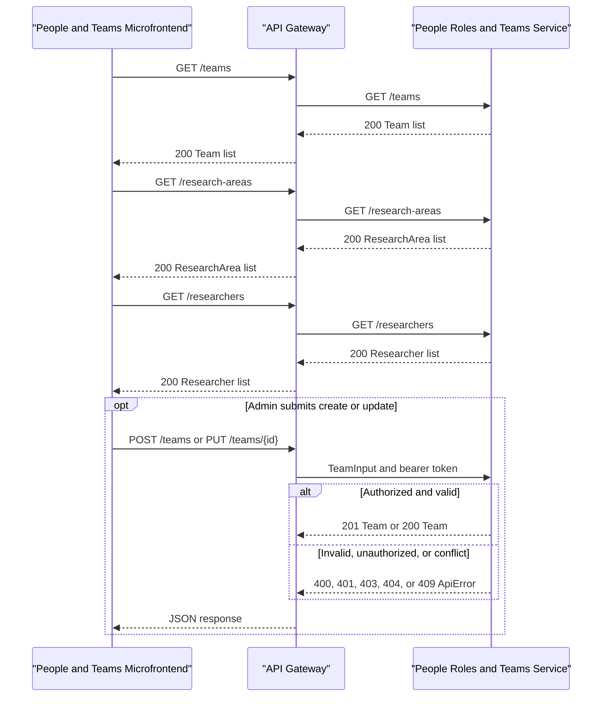

# API & Service Communication Contracts

This repository contains a Teams microfrontend and its REST client, but not the API Gateway or backend implementation. The proposed contract below is derived from the frontend calls and is also specified in [openapi.yaml](../../../../../docs/openapi.yaml).

## Service Catalog

| Service | Port | Category | Purpose |
|---|---|---|---|
| People & Teams microfrontend | Not fixed in project configuration | Client | Displays the team directory and provides admin create/edit forms. |
| API Gateway | Supplied by the host Shell; not implemented here | API Layer (external) | Base URL used by the REST client; routes requests to the People, Roles & Teams service. |
| People, Roles & Teams service | Not specified; backend is outside this repository | Business (proposed) | Owns teams and supplies research-area and researcher lookups. |

## API Endpoints Inventory

These are the paths called by the frontend client, relative to the configured API Gateway base URL. They are a proposed backend contract, not server routes implemented in this repository.

| Service | Method | Path | Request Type | Response Type |
|---|---|---|---|---|
| People, Roles & Teams service | GET | `/teams` | None | `Team[]` |
| People, Roles & Teams service | POST | `/teams` | `TeamInput` JSON | `Team` JSON |
| People, Roles & Teams service | PUT | `/teams/{id}` | Path `id` and `TeamInput` JSON | `Team` JSON |
| People, Roles & Teams service | GET | `/research-areas` | None | `ResearchArea[]` |
| People, Roles & Teams service | GET | `/researchers` | None | `Researcher[]` |

Create returns `201`; update returns `200`. Writes may return `400`, `401`, `403`, `404` (update), or `409`; reads return `200` and may return `401`. Team field definitions and error schemas are in the OpenAPI file. There is no delete operation, server-side filtering, or pagination in the current frontend contract; directory filters are applied in the browser.

## Management & Observability Endpoints

No health, metrics, or management endpoints are defined by this microfrontend contract. The backend and gateway are not present in this repository.

## DTOs & Contracts

- `TeamInput` is the request body for create and full replacement.
- `Team` is the response for list, create, and update; the server supplies `id` and `updatedAt`.
- `ResearchArea` and `Researcher` are lookup response types.
- The frontend uses structural TypeScript interfaces, with JSON serialization through `fetch`. Full field definitions, length constraints, and error shape are specified in [openapi.yaml](../../../../../docs/openapi.yaml).
- The client loads areas and researchers separately; no gateway aggregation DTO is currently represented.

### Mapping to the shared ERD

- `TeamInput.areaIds` and `ResearchArea` are API-facing names for research topics. The backend maps these IDs through `team_topics` to `research_topics`.
- `TeamInput.leaderId` maps to `team_members` with `is_leader = true`. The form does not send `start_date` or `end_date`; the backend needs a policy for those fields.
- The frontend expects string IDs, while the ERD uses serial/integer IDs. The API should serialize database IDs as strings unless the frontend contract is deliberately changed.
- `teams.status` is not part of the current form or API DTO. The backend should own its value/default; the permitted values are not specified by the ERD.
- `Team.updatedAt` is required by the current frontend type but has no corresponding column in the ERD. Before implementing the API, either add a persisted update timestamp to the data model or remove this field from the frontend/API contract.
- Team create/update should persist the team and its `team_topics` and leader association consistently. The current form does not manage ordinary team members, so updates must not remove membership rows that the UI cannot see.
- Contracts, researcher topics, projects, and project assignments appear in the ERD but have no corresponding functions in this microfrontend; they are outside this API surface.

## Communication Patterns

- The frontend uses synchronous request/response REST calls with JSON through `fetch`, targeting the API Gateway base URL supplied in `MountOptions.apiBaseUrl`.
- If `getToken` supplies a token, the client sends it as a bearer token. The UI's `isAdmin` flag only hides write controls; the backend must enforce administrator authorization and return `403` for unauthorized writes. `401` is presented as an expired session.
- No retries, timeouts, circuit breakers, asynchronous messaging, service discovery, or gateway aggregation behavior is implemented or configured in this repository.
- The paths have no API version prefix. A deployment prefix can be supplied through the gateway base URL.
- TLS is not configured in this repository; deployed environments should use HTTPS at the gateway, especially when forwarding bearer tokens.
- Error handling in the client ([api.ts](../../../../../src/api.ts)):
  - `401` is presented as an expired session and `403` as a missing permission; neither body is read.
  - For other failures, the `message` of a JSON `ApiError` body is shown. A body that is not JSON (for example an HTML error page from the gateway) is ignored and a status-based message is shown instead.
  - `fieldErrors` are mapped onto the matching form fields (`name`, `description`, `areaIds`, `leaderId`; unknown keys are dropped). A `409` is treated as a team-name conflict and shown on the name field, as the OpenAPI file documents it only as such.
  - A network failure is reported as an unreachable server.
- Successful responses are checked against the documented shape (every `Team` field except `updatedAt`, which the UI never reads; `id` and `name` for lookups). Anything else is reported as an unexpected response, with Retry, instead of reaching the UI. As a last resort, the microfrontend wraps itself in an error boundary so a rendering crash cannot blank the Shell's slot.

## Service Technology Matrix

| Service | Web | Data Access | Discovery | Gateway | Actuator | Cache | Metrics |
|---|---|---|---|---|---|---|---|
| People & Teams microfrontend | React, Vite | N/A | N/A | No | N/A | N/A | N/A |
| API Gateway | Not in repository | Not in repository | Not specified | Yes (external) | Not specified | Not specified | Not specified |
| People, Roles & Teams service | Not implemented here | Not specified | Not specified | No | Not specified | Not specified | Not specified |

## Service Communication Sequence

<!-- mermaid-checked: every participant uses `participant Id as "Label"`, no \n in aliases/messages/notes, every alt/opt/loop closed by end, no `:` inside any alias -->

